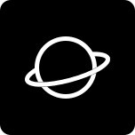

  

<h1 align="center">Saturn</h1>

  Python 桌面 UI 框架：用一棵控件树构建本地应用界面。

  
  
  

Saturn 借鉴 Flet 等声明式 UI 框架的开发体验，但运行时、渲染器和功能覆盖
由 Saturn 自己实现。它主要面向 Python 桌面应用，也提供可选的浏览器会话
运行时。

> Saturn 目前处于 alpha 阶段。API 和功能覆盖可能变化；在生产应用中使用前，
> 请先阅读对应章节，并验证应用实际依赖的行为。

## 开始使用

先读 [Saturn 使用手册](./docs/README.md)。章节从项目脚手架开始，逐步介绍
页面、控件、布局、事件、输入、主题、窗口、渲染器和 Web。完整参数列表见
[API 参考](./docs/api/README.md)。

在 Windows 开发环境中克隆仓库并运行示例：

~~~powershell
git clone https://github.com/the-OmegaLabs/Saturn.git
cd Saturn
uv sync
uv run python examples/hello.py
~~~

一个最小窗口：

~~~python
import saturn

class Application:
    def __init__(self):
        self.page = None

    def create_window(self, page: saturn.Page):
        self.page = page
        page.title = "Hello Saturn"
        page.add(saturn.Text(value="Hello, World!"))

if __name__ == "__main__":
    application = Application()
    saturn.run(main=application.create_window)
~~~

将入口方法传给 saturn.run，不要提前调用它；框架启动窗口后会把 Page 传入。
完整项目结构和状态更新示例见[项目脚手架](./docs/getting-started.md)。

## 框架能力

Saturn 提供常用布局、文字和媒体、按钮与输入、对话框、主题、动画、原生子
窗口和 GPU 着色器。桌面默认使用 OpenGL，也可以选择软件后端；Vulkan 仍是
实验性后端。可选的 saturn.web 运行时支持浏览器中的共享页面与会话。

浏览[截图画廊](./docs/gallery.md)，或直接运行示例：

~~~powershell
uv run python examples/demo.py --backend opengl
uv run python examples/expressive_demo.py
~~~

## 文档入口

- [安装、脚手架与入门章节](./docs/README.md)
- [全部公开 API 符号](./docs/api/README.md)
- [与 Flet 的映射和限制](./docs/flet-mapping.md)
- [Compose 与 Expressive 控件](./docs/compose.md)
- [Web 会话](./docs/web.md)
- [子窗口](./docs/subpages.md)
- [渲染器和 GPU 选择](./docs/rendering.md)
- [GLSL 着色器](./docs/shaders.md)
- [平台适配层与 Win32 拆分](./docs/platform-adapters.md)
- [Linux 桌面路线图](./docs/linux-desktop-roadmap.md)

## 第三方资源

saturn/_gen/loading_shapes.json 中的图形由 AndroidX Compose Material 3 和
Graphics Shapes 派生，按 Apache License 2.0 分发。来源和许可文本见
[NOTICE](./saturn/_gen/NOTICE.md) 与[许可证](./saturn/_gen/LICENSE-APACHE-2.0.txt)。

Orb GLSL 示例改编自 [LerSent001/orb](https://github.com/LerSent001/orb)；
上游 MIT 许可证与版权声明保留在
[ORB-LICENSE.txt](./.static/shaders/ORB-LICENSE.txt)。

Saturn 由 Omega Labs 维护，欢迎提交问题和贡献。项目许可证信息将在之后公布。
