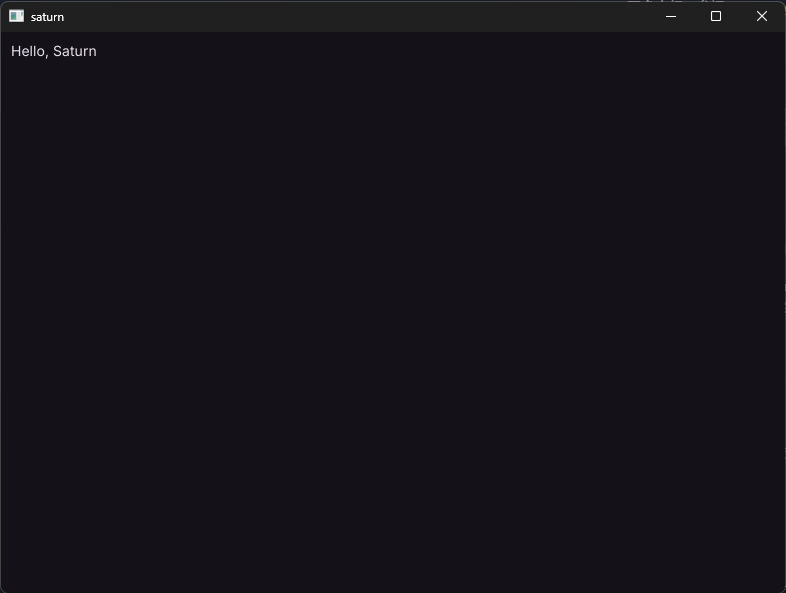

# Welcome to Saturn

Saturn is a **modern, lightweight, GPU-accelerated** Python desktop UI framework.

For more information, see [the-OmegaLabs/Saturn.git](https://github.com/the-OmegaLabs/Saturn).

~~~python
import saturn

def main(page: saturn.Page):
    page.add(saturn.Text("Hello, Saturn"))

saturn.run(main)
~~~

This is the minimal implementation for creating a window with Saturn; the result looks like this:



This code uses `saturn.run` to create a window and passes a `saturn.Page` to the `main` function. `main` can be a **plain function, a bound method, or an async function**.

## Core concepts:

### The root `saturn.Page`

`Page` represents the application page inside a window. It owns the top-level `controls`, theme, fonts, dialogs,
services, and event handlers. You can manage its direct children with `add`, `insert`, `remove`, and `clean`.

`page.controls` is the list of controls belonging to a `Page`. You can manage its direct children with `add`, `insert`, `remove`, and `clean`.

`page.window` manages the native window and its properties.

`page.renderer` manages the current renderer and its settings.

---

### Control nodes `saturn.Control`

`Control` represents a control in an application; controls are the ways users interact with the application. `Text`, `Button`, `Row`, `Column`, `Container`, `TextField`, and so on are all `Control`s.

Some **controls** can also own **child controls**.

For example:

`saturn.Row` and `saturn.Column` hold multiple child controls through their `.controls` property, usually a `list`.

`saturn.Container` and similar wrap a single child through their `.content` property. Each control belongs to at most one control tree.

---

### Automatic control updates

In most cases you don't need to update control state manually. After you modify `value`, `checked`, or child `controls` properties, Saturn automatically re-syncs controls, lays out, and draws. When one operation modifies multiple properties, it's usually best to trigger a single update at the end.

If you don't want controls to update automatically, set `page.auto_update` to `False`. When you do need to update a control,
call the control's `control.update()` or the page's `page.update()`.

### Renderers

Saturn supports software rendering, OpenGL, and an experimental Vulkan backend. Saturn uses
OpenGL by default. If GPU initialization fails, it falls back to software rendering. If you want to know which renderer is active, query the
`page.renderer.name` property.

If you want to use a specific renderer, you can explicitly specify it when creating the window.

```python
saturn.run(**, backend=saturn.Renderer.SOFTWARE)
saturn.run(**, backend=saturn.Renderer.OPENGL)
saturn.run(**, backend=saturn.Renderer.VULKAN)
```

Unless you have a special reason, the OpenGL renderer is recommended by default.

## Saturn's relationship with Flet

In actual development you will find that Saturn is, to some extent, very similar to [Flet](https://flet.dev/).

Saturn uses many familiar names: `Page`, `Text`, `Button`, `Row`, `Column`, `TextField`,
and `FilePicker`, among others. This makes it easier for developers with Flet experience to get started, but they are not the same implementation.

Saturn was born out of my dissatisfaction with some of the design decisions and features of [Flutter](https://flutter.dev/) and Flet, and my search for a more ideal UI framework. Saturn is still in the Alpha stage. The content covered in this guide, as well as the controls, APIs, and interfaces currently provided, may change in future releases, including incompatible breaking changes.

If you are interested in Saturn, contributions are welcome to help improve the project.

---

If you want to migrate your application from Flet, or port new controls, first check the [feature mapping](../flet-mapping.md), then the
[parameter comparison table](../control-parameters-comparison.md). This book covers the common Saturn
development paths; the API pages record the signatures actually supported by the current version. (The actual code is the source of truth.)

## When to choose Saturn?

Saturn is a good fit for:

- Tools that need native Python desktop windows, input, layout, and Material-style controls;
- Applications where UI state and events should run locally, in-process;
- Applications that need native subwindows, renderer selection, or GPU shaders;
- Anyone who wants to start from a small, familiar API set and adopt the Expressive and Web extensions as needed.

If your application depends on mobile components, services, or parameters that Saturn does not yet implement, you should confirm alternatives first,
or keep using Flet.

## Key points of this chapter

A Saturn application starts with `saturn.run`; `Page` is the root, `Control`s form the tree, events modify state,
and `.update` requests a repaint. In the next chapter we will set up the development environment and then build a standard Saturn application scaffold.
