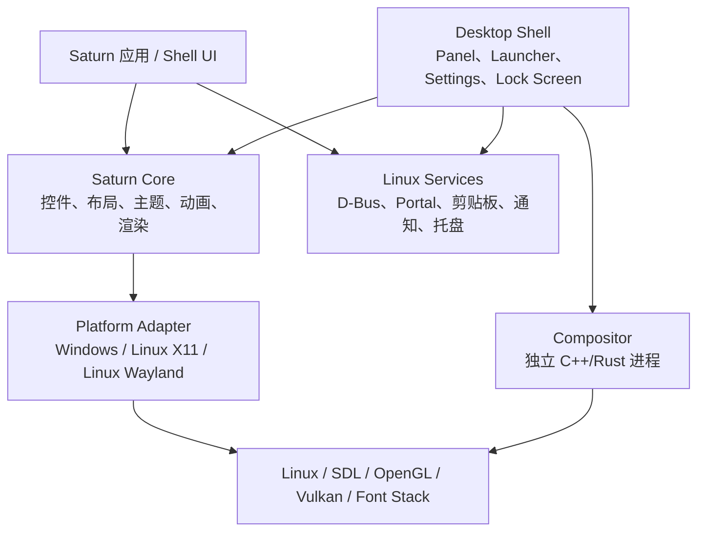

# Saturn Linux 改造与桌面环境路线图

> 评估日期：2026-10-11\
> 当前基线：Saturn 0.1.0，Alpha 级别\
> 目标：把 Saturn 从 Windows 优先的 GPU 桌面 UI 框架，逐步发展为 Linux 桌面应用框架、桌面 Shell 工具包，并评估完整桌面环境的可行性。

## 1. 结论

Saturn 有做 Linux 桌面软件的潜力，但现阶段的定位是 **桌面 UI 框架**，不是桌面环境本身。

建议把目标拆成三层：

| 目标 | 可行性 | 当前成熟度 | 说明 |
| --- | --- | --- | --- |
| Linux 桌面应用框架 | 高 | 中低 | SDL 已提供窗口、输入和基础图形通道，适合先完成这一步 |
| 启动器、面板、设置中心、通知中心等桌面 Shell | 中高 | 低 | 需要 Wayland/X11 原生协议、D-Bus、桌面门户和系统服务 |
| GNOME/KDE 级完整桌面环境 | 长期可行 | 很低 | 需要 compositor、会话、锁屏、无障碍、系统服务和发行版集成，不能只做 Linux 后端 |

最合理的路线是：

```text
Saturn UI 核心
      ↓
Linux 应用框架
      ↓
Shell 组件（面板、启动器、设置、通知）
      ↓
独立 compositor 与系统服务
      ↓
完整桌面环境
```

## 2. 当前项目能力盘点

### 2.1 已有基础

- Python 控件树、布局、主题、事件和动画系统。
- Software、OpenGL 和实验性 Vulkan 渲染后端。
- SDL/pygame 提供窗口、鼠标、键盘、文本输入和基础事件循环。
- `Subpage` 支持同一进程中的多个原生窗口。
- 已有焦点遍历、文本选择、剪贴板、IME、滚动、列表和文件选择能力。
- 支持自定义控件、Shader、字体、图像、Material 风格控件。
- 有行为测试、渲染测试、字体测试、输入测试和 C++ 行为测试。
- C++/SDL3/OpenGL 核心已经开始建设，可作为长期的原生运行时方向。

### 2.2 当前限制

- 项目仍是 Alpha，文档明确说明目前主要在 Windows 上开发和测试。
- [saturn/_native_window.py](../saturn/_native_window.py) 直接依赖 Win32、DWM、COMCTL32 和 HWND。
- [saturn/window.py](../saturn/window.py) 中不少窗口能力在非 Windows 系统上会抛出 `NotImplementedError`。
- DPI、窗口边框、窗口位置、透明度、标题栏、任务栏进度和窗口拖拽主要按 Windows 语义实现。
- 尚未形成完整的 Linux X11/Wayland 平台适配层。
- 尚未看到完整的 D-Bus、xdg-desktop-portal、通知、托盘、桌面入口、系统设置和会话服务集成。
- 没有原生无障碍树和屏幕阅读器 provider。
- 复杂文字塑形、双向文字、复杂脚本和彩色 Emoji 还不是完整能力。
- 原生菜单、系统托盘、原生拖放、富文本剪贴板、目录模型和文件监听仍需补充。
- C++ 部分仍在逐步实现功能，不能直接视为完整生产级桌面运行时。

### 2.3 代码层面的关键事实

| 文件 | 事实 | 对 Linux 改造的含义 |
| --- | --- | --- |
| `saturn/app.py` | SDL 窗口、渲染器和 UI 线程集中管理 | 可以保留事件循环，但需要抽离平台服务 |
| `saturn/window.py` | 统一暴露窗口属性，但部分属性 Windows-only | 需要能力协商和 Linux 实现，不宜继续扩大通用 API 假设 |
| `saturn/_native_window.py` | Win32 原生窗口适配器 | 应替换成平台适配器目录，而不是向其中继续追加 Linux 分支 |
| `saturn/services.py` | FilePicker 使用 Tkinter，Clipboard 依赖 pyperclip/SDL 路径 | Linux 应优先接入 portal、Wayland/X11 剪贴板和系统服务 |
| `saturn/renderer/` | 有 Software/OpenGL/Vulkan 代码 | 适合先做 Linux 图形验证和 GPU 回退 |
| `cpp/` | SDL3/OpenGL C++ 核心骨架 | 适合承载 compositor、原生协议和高可靠系统边界，当前功能尚未完整 |
| `docs/feature-feasibility.md` | 已明确 Linux/macOS 原生集成不完整 | 应把这份路线图作为平台化工作的上位计划 |

## 3. 必须先澄清的产品边界

### 3.1 Linux 桌面应用框架

这是最现实的第一目标。应用通过 Saturn 创建普通桌面窗口，在 GNOME、KDE、XFCE、Sway 等现有桌面环境中运行。

需要完成：

- X11 和 Wayland 普通顶层窗口。
- OpenGL、Software，随后再验证 Vulkan。
- 高 DPI/分数缩放和多显示器。
- 字体、输入法、剪贴板、拖放和文件选择。
- Linux 原生窗口状态、图标、全屏、透明度和窗口事件。
- `.desktop`、图标、发行版包和应用资源查找。

### 3.2 Linux 桌面 Shell

这是面板、启动器、桌面背景、通知中心、控制中心、锁屏界面等组件的集合。它们通常不是普通的应用窗口。

Wayland 下，面板和桌面背景通常需要 `wlr-layer-shell` 或桌面环境提供的等价协议；普通 SDL 顶层窗口不能自动获得这些能力。X11 下则需要 EWMH/NETWM、Dock 类型窗口、工作区和窗口管理约定。

### 3.3 完整桌面环境

完整桌面环境还要拥有或依赖：

- Wayland compositor 或 X11 window manager。
- 会话启动与退出。
- 锁屏、登录和权限边界。
- 显示器、音频、网络、蓝牙、电源管理。
- 通知、托盘、桌面入口和 MIME 关联。
- 输入法和无障碍服务。
- xdg-desktop-portal 后端。
- 崩溃隔离、升级和配置迁移。

这部分应是独立的原生系统工程，Saturn 主要提供界面层。

## 4. 建议的目标架构



建议拆成以下边界：

```text
saturn/core/                 平台无关控件、布局、渲染接口
saturn/platform/windows/     Win32、DWM、任务栏和 Windows DPI
saturn/platform/linux/       Linux 通用能力
saturn/platform/linux/x11/   X11/EWMH/ICCCM 适配
saturn/platform/linux/wayland/ Wayland/XDG 适配
saturn/services/             D-Bus、Portal、通知、托盘、系统服务
saturn/shell/                面板、启动器、设置、桌面背景
cpp/                         原生渲染、协议和高可靠系统边界
compositor/                  独立 compositor 项目，不塞进普通 App
```

平台能力不应由“是否 Windows”判断，而应由能力表描述，例如：

```python
page.platform.capabilities = {
    "window_position": True,
    "window_opacity": False,
    "layer_shell": True,
    "global_shortcuts": False,
    "native_file_picker": True,
    "screen_reader": False,
}
```

对于 Wayland 不允许的能力，应返回明确的能力状态或抛出带平台说明的异常，不能伪造成功。

## 5. Linux 改造工作清单

### 5.1 平台基础层

- [ ] 抽离 Win32 代码，禁止公共模块直接导入 `ctypes.windll`。
- [ ] 建立 `PlatformWindow`、`DisplayManager`、`ClipboardBackend`、`FileDialogBackend` 等接口。
- [ ] 建立 Linux 平台检测：发行版、显示服务器、SDL 视频驱动、GPU、缩放因子。
- [ ] 明确 X11、Wayland、无显示器和远程桌面环境的行为。
- [ ] 统一窗口坐标、逻辑像素、物理像素和 framebuffer 尺寸。
- [ ] 支持多显示器、显示器热插拔和分数缩放。
- [ ] 验证窗口创建、关闭、隐藏、聚焦、全屏、最大化、最小化和 resize 事件。
- [ ] 验证窗口图标、标题、透明度、背景和边框行为。
- [ ] 对 Wayland 不支持的窗口定位、全局输入、输入注入等能力做能力声明。

### 5.2 渲染和输入

- [ ] Ubuntu、Fedora 至少各有一套 OpenGL/Software CI。
- [ ] X11 和 Wayland 都验证 OpenGL 上下文创建、交换链和 resize。
- [ ] Vulkan 在 Linux 上单独验证驱动、loader、窗口 surface 和 GPU 选择。
- [ ] 保留 Software 后端，用于无 GPU、远程桌面和自动化测试。
- [ ] 检查 Mesa、Intel、AMD、NVIDIA 驱动。
- [ ] 接入 FreeType、Fontconfig 和 HarfBuzz，补足复杂脚本塑形。
- [ ] 验证阿拉伯语、印地语、中文、日文、韩文、RTL、组合字符和 Emoji。
- [ ] 验证 IBus/Fcitx 输入法、候选框位置、预编辑和提交。
- [ ] 验证键盘布局、`xkbcommon`、快捷键、Dead Key 和 Compose Key。
- [ ] 验证触摸板滚动、鼠标高分辨率滚轮和触摸输入。

### 5.3 Linux 系统服务

- [ ] 剪贴板：X11 selection、Wayland data-control 或 SDL 后端。
- [ ] 文件选择：优先使用 `xdg-desktop-portal`，Tkinter 作为临时后备。
- [ ] 文件拖放：支持本地路径、URI、文本和取消操作。
- [ ] 通知：实现 `org.freedesktop.Notifications`，包括图标、动作、超时和关闭事件。
- [ ] 托盘：优先实现 StatusNotifierItem，X11 环境提供兼容路径。
- [ ] 桌面入口：解析 `.desktop`、图标主题、启动参数和 MIME 关联。
- [ ] 全局快捷键：在 X11 实现明确后，再为 Wayland 采用 compositor 或桌面门户方案。
- [ ] 电源、网络、蓝牙和音量：通过 UPower、NetworkManager、BlueZ、PipeWire/PulseAudio 等系统接口访问。
- [ ] 设置存储：明确使用配置文件、GSettings、D-Bus 或自有配置数据库。
- [ ] 会话：支持 systemd user session、注销、关机、重启和应用退出通知。

### 5.4 Shell 组件

- [ ] Panel：位置、尺寸、自动隐藏、工作区、窗口列表、托盘和通知入口。
- [ ] Launcher：应用搜索、`.desktop` 启动、收藏、最近使用和权限提示。
- [ ] Desktop：壁纸、多显示器、桌面图标或明确不提供桌面图标。
- [ ] Control Center：显示、网络、声音、蓝牙、电源、主题、键盘和输入法。
- [ ] Notification Center：历史记录、动作、分组、勿扰模式和持久化。
- [ ] Lock Screen：输入密码、屏幕遮罩、会话恢复和 compositor 协作。
- [ ] Window Rules：应用匹配、默认工作区、最大化和浮动策略。
- [ ] Accessibility：AT-SPI2 角色、名称、状态、动作、焦点和变化通知。
- [ ] Internationalization：gettext/翻译目录、复数规则、日期、数字和时区。

### 5.5 Compositor 或 Window Manager

这是完整桌面环境的独立工作流：

- [ ] 选择 Wayland compositor 技术路线：wlroots、Smithay 或自研。
- [ ] 决定 Saturn 与 compositor 的进程边界。
- [ ] 实现输出管理、输入设备、窗口映射、焦点、层级和工作区。
- [ ] 实现 `xdg-shell`、layer-shell、屏幕截图、屏幕录制和拖放协议。
- [ ] 实现 XWayland 支持，兼容旧 X11 应用。
- [ ] 实现锁屏、权限、虚拟终端和 session/seat 管理。
- [ ] 实现 compositor 崩溃后的重启或安全退出策略。
- [ ] 不把 compositor 放进 Python UI 线程，不让普通控件崩溃拖垮整个桌面。

## 6. 推荐依赖方向

### 6.1 应用框架阶段

- SDL2/SDL3：窗口、输入、基础事件和图形上下文。
- OpenGL/Mesa：主 GPU 路径。
- Vulkan loader/headers：实验性 Vulkan 路径。
- FreeType、Fontconfig、HarfBuzz：字体发现、栅格化和复杂脚本塑形。
- xkbcommon：键盘布局和按键解析。
- Wayland/XCB/Xlib：Linux 原生协议适配。
- xdg-desktop-portal：文件选择、屏幕共享和受控桌面能力。
- D-Bus：通知、系统设置、会话和系统服务。

### 6.2 Shell 阶段

- Wayland layer-shell 协议实现或绑定。
- StatusNotifierItem/DBusMenu。
- systemd-logind 和 systemd user services。
- UPower、NetworkManager、BlueZ、PipeWire/PulseAudio。
- AT-SPI2 无障碍接口。
- IBus/Fcitx 输入法接口。

### 6.3 依赖原则

- UI 控件和布局保持 Saturn 自有实现。
- 系统能力优先使用标准 Linux 协议，不绑定某个发行版的私有 API。
- 原生协议、compositor、输入和安全边界优先放在 C++ 或 Rust。
- Python 保留用于 UI 编排、应用开发和快速迭代。

## 7. 分阶段路线

### Phase 0：架构冻结与平台抽象

目标：让 Linux 工作不再依赖追加零散的 `sys.platform` 分支。

当前状态：平台适配器、Win32 原生窗口/GPU 代码隔离和非 Windows 空适配器已
完成；Linux X11/Wayland 原生协议与系统服务仍未实现。

- [x] 建立平台能力接口和 capability 查询。
- [x] 将 `_native_window.py` 重构为平台适配器。
- [ ] 确认普通应用框架和 Desktop Shell 的 API 边界。
- [ ] 决定 X11 与 Wayland 的首发顺序。
- [ ] 设计系统服务接口和 mock backend。
- [ ] 增加 Linux 代码风格、依赖和错误处理规范。

### Phase 1：Linux 普通应用框架

目标：Saturn 应用可以在现有 Linux 桌面环境中稳定运行。

- [ ] Ubuntu/Fedora 的 X11 与 Wayland 启动验证。
- [ ] Software/OpenGL 窗口、输入、字体和 resize 全部可用。
- [ ] 文件门户、剪贴板、拖放、输入法和 DPI 可用。
- [ ] 多显示器和分数缩放可用。
- [ ] 打包成 wheel、系统包和最小示例应用。
- [ ] 完成跨平台测试矩阵。

### Phase 2：Saturn Shell MVP

目标：在现有 compositor 上运行可用的 Saturn 桌面壳组件。

- [ ] Panel。
- [ ] Launcher。
- [ ] Notification Center。
- [ ] Settings/Control Center。
- [ ] `.desktop` 应用启动和图标主题。
- [ ] D-Bus 通知和 StatusNotifierItem。
- [ ] Wayland layer-shell/X11 Dock 适配。
- [ ] 基础多显示器布局。

### Phase 3：独立桌面环境

目标：Saturn Shell 不再依赖 GNOME/KDE 的窗口管理政策。

- [ ] 独立 compositor 或 window manager。
- [ ] 登录、会话、锁屏和注销。
- [ ] XWayland 兼容。
- [ ] xdg-desktop-portal 后端。
- [ ] 电源、网络、蓝牙、声音和显示管理。
- [ ] AT-SPI2 无障碍。
- [ ] 崩溃恢复、升级和配置迁移。
- [ ] 发行版安装器、默认配置和文档。

## 8. 测试矩阵

### 8.1 最低平台矩阵

| 操作系统 | 显示服务器 | 后端 | 目的 |
| --- | --- | --- | --- |
| Ubuntu LTS | X11 | Software/OpenGL | 基础兼容和 CI |
| Ubuntu LTS | Wayland | Software/OpenGL | 主流 Wayland 路径 |
| Fedora | Wayland | OpenGL | 新版 Mesa/Wayland |
| Fedora | X11 | OpenGL | X11 回退 |
| Arch 或滚动发行版 | Wayland | Vulkan | 新版协议和驱动验证 |
| Windows | Win32 | Software/OpenGL/Vulkan | 防止 Linux 改造破坏现有能力 |

### 8.2 硬件与场景

- [ ] Intel、AMD、NVIDIA。
- [ ] 100%、125%、150%、200% 缩放。
- [ ] 单显示器、异构多显示器、热插拔。
- [ ] 本地会话、远程桌面、无 GPU、软件渲染。
- [ ] 英文、中文、日文、阿拉伯文、印地文和 RTL。
- [ ] IBus、Fcitx、无输入法环境。
- [ ] 普通应用窗口、layer-shell 窗口、全屏、透明窗口和多窗口。

### 8.3 验证类型

- [ ] 单元测试：平台能力、坐标转换、窗口状态和协议消息。
- [ ] 行为测试：键盘、焦点、IME、剪贴板、拖放、窗口生命周期。
- [ ] 渲染测试：Software/OpenGL/Vulkan 截图和 resize 回归。
- [ ] 系统测试：portal、D-Bus、通知、托盘、`.desktop` 启动。
- [ ] 压力测试：多窗口、长时间动画、频繁显示器变化和 GPU 重置。
- [ ] 无障碍测试：Orca、AT-SPI2、键盘全流程。
- [ ] 崩溃测试：UI 进程、Shell 组件和 compositor 分别崩溃时的恢复行为。

自动化环境可以考虑：

- X11：Xvfb 或真实虚拟机。
- Wayland：Weston headless 或嵌套 compositor。
- GPU：Mesa llvmpipe 作为软件基线，真实 Intel/AMD/NVIDIA 作为硬件验证。

## 9. 打包和发行

### 普通 Saturn 应用

- [ ] Python wheel，明确 Linux 依赖和可选 Vulkan 依赖。
- [ ] Ubuntu/Debian 的 deb 包。
- [ ] Fedora 的 rpm 包。
- [ ] Flatpak manifest，限制权限并声明 D-Bus/portal 权限。
- [ ] `.desktop` 文件、图标和 MIME 文件。
- [ ] 资源路径不依赖当前工作目录。
- [ ] 发布调试符号、日志开关和崩溃报告策略。

### Shell/桌面环境

- [ ] systemd user service。
- [ ] D-Bus service 文件。
- [ ] xdg-desktop-portal backend 文件。
- [ ] 默认配置、主题、图标和字体资源。
- [ ] 安装、卸载、升级和回滚脚本。
- [ ] 安全升级与配置迁移。

## 10. 非功能要求

### 性能

- 普通桌面窗口在目标硬件上稳定保持 60 FPS。
- 面板和通知中心不因后台服务阻塞而卡顿。
- UI 线程不得执行阻塞式 D-Bus、文件扫描或网络操作。
- GPU 不可用时有可预测的 Software 回退。
- 多个 Shell 组件不会无限复制 Python 运行时和字体缓存。

### 稳定性

- 普通应用崩溃不应导致 Shell 或 compositor 退出。
- Shell 服务可独立重启。
- 原生资源、窗口、GPU 上下文和线程全部有明确所有权。
- 协议异常、无效路径、超大图像和自定义 Shader 必须有边界检查。

### 安全

- 不默认允许全局输入注入、任意屏幕读取或任意文件访问。
- portal 权限和 D-Bus 权限最小化。
- 自定义 Shader、字体、图像和外部路径必须校验。
- compositor、Shell 和普通应用的权限边界清晰。

### 可访问性和国际化

- 公开的 semantics 信息必须映射到 AT-SPI2 role/name/state/action。
- 焦点、键盘、缩放和高对比度主题要有完整测试。
- 使用 HarfBuzz 处理复杂脚本和双向文字。
- 翻译、复数、数字、日期、时区和键盘布局不能只按英文假设。

## 11. 各阶段验收标准

### Linux 应用框架 Beta

- [ ] Ubuntu 和 Fedora 的 X11/Wayland 均可运行示例和测试。
- [ ] Software/OpenGL 后端通过核心行为和截图测试。
- [ ] 文件选择、剪贴板、拖放、IME、DPI、多显示器可用。
- [ ] 有可安装 wheel、deb/rpm 或 Flatpak。
- [ ] 文档明确列出平台能力差异。

### Shell MVP

- [ ] Panel、Launcher、Settings、Notification Center 可独立启动和退出。
- [ ] X11 Dock 与 Wayland layer-shell 均能正确占用工作区。
- [ ] 通知、托盘、应用启动和多显示器均可用。
- [ ] Shell 组件崩溃后可以单独重启。
- [ ] 至少通过一种屏幕阅读器的基础操作测试。

### 完整桌面环境首个可用版本

- [ ] 可从登录到注销完成完整会话流程。
- [ ] compositor、Shell、portal 和系统服务协同工作。
- [ ] 可运行 X11 和 Wayland 应用。
- [ ] 锁屏、显示器、电源、网络、声音和输入法可用。
- [ ] 普通应用、Shell 和 compositor 之间有明确的崩溃隔离。
- [ ] 至少在一个稳定发行版上提供可重复安装和升级方案。

## 12. 风险和应对

| 风险 | 影响 | 应对 |
| --- | --- | --- |
| 把普通 SDL 窗口误当成桌面 Shell | 架构返工 | 先建立 layer-shell/compositor 原型，单独定义 Shell 平台接口 |
| 只验证导入成功，没有 Linux 实机验证 | 发布后窗口、输入、字体全部出问题 | 建立 X11/Wayland CI 和真实硬件矩阵 |
| 继续扩大 Windows-specific Window API | Linux API 永远被迫模拟 Windows | 改为 capability API，并记录平台差异 |
| Python 进程过多导致内存和启动性能差 | Shell 体验不稳定 | 核心服务合并或移至 C++/Rust，UI 保持 Python/高层 API |
| 自研 compositor 范围失控 | 项目长期无法交付 | 先基于 wlroots/Smithay 做最小集成，再决定是否自研 |
| 忽视无障碍和复杂文字 | 无法成为成熟桌面环境 | 将 AT-SPI2、HarfBuzz、输入法列为正式里程碑 |
| 依赖发行版私有接口 | 跨发行版维护成本高 | 优先使用 Wayland、D-Bus、portal、EWMH 等标准接口 |
| GPU/驱动差异 | 黑屏、闪烁、性能回退 | Software 基线、Mesa CI、真实 Intel/AMD/NVIDIA 验证 |

## 13. 推荐的第一个可交付版本

不要一开始就做完整桌面环境。建议先交付一个 **Saturn Linux Shell Kit**：

1. Linux 普通应用框架稳定运行。
2. 一个 Wayland/X11 兼容的面板。
3. 一个可搜索 `.desktop` 应用的启动器。
4. 一个设置中心，先覆盖显示、主题、网络和声音入口。
5. D-Bus 通知中心和基础托盘。
6. 可安装的 Flatpak 或 deb/rpm 包。
7. 完整的 X11/Wayland、Software/OpenGL、DPI、IME 和多显示器测试。

这个版本可以验证 Saturn 是否真的适合桌面 Shell，同时不会过早承担 compositor、登录管理和完整系统服务的全部风险。

## 14. 最终判断

Saturn 具备成为 **Linux 桌面 UI 与 Shell 框架** 的技术基础，尤其适合启动器、设置中心、控制面板、通知界面和轻量桌面应用。

要成为完整桌面环境，需要把项目分成“UI 框架”和“系统桌面栈”两部分。当前最重要的工作不是继续添加控件，而是完成 Linux 平台抽象、Wayland/X11 协议适配、系统服务、无障碍、复杂文字和跨发行版测试。

如果坚持以现有 Python/SDL 代码直接扩展为完整桌面环境，成功风险很高；如果保留 Saturn 作为 UI 层，并用 C++/Rust 建设 compositor 和系统服务，长期做出一个轻量 Linux 桌面环境是可行的。
