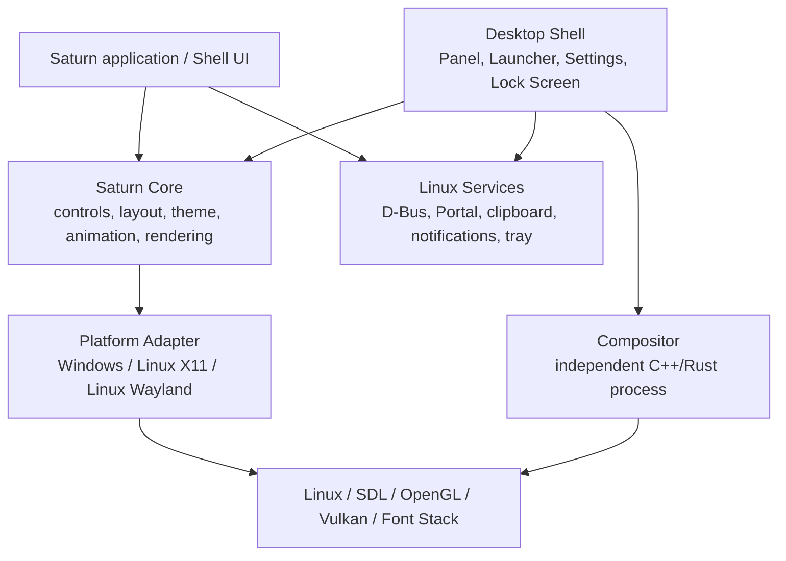

# Saturn Linux Adaptation and Desktop Environment Roadmap

> Assessment date: 2026-10-11\
> Current baseline: Saturn 0.1.0, Alpha level\
> Goal: gradually evolve Saturn from a Windows-first GPU desktop UI framework into a Linux desktop application framework and desktop shell toolkit, and assess the feasibility of a full desktop environment.

## 1. Conclusion

Saturn has the potential to make Linux desktop software, but at this stage its positioning is a **desktop UI framework**, not a desktop environment itself.

It is recommended to split the goal into three layers:

| Goal | Feasibility | Current maturity | Notes |
| --- | --- | --- | --- |
| Linux desktop application framework | High | Medium-low | SDL already provides windows, input, and a basic graphics channel; this step is the right one to complete first |
| Desktop shell: launcher, panel, settings center, notification center, etc. | Medium-high | Low | Requires Wayland/X11 native protocols, D-Bus, desktop portals, and system services |
| A full GNOME/KDE-grade desktop environment | Feasible long-term | Very low | Requires a compositor, session, lock screen, accessibility, system services, and distribution integration; a Linux backend alone is not enough |

The most reasonable path is:

```text
Saturn UI core
      ↓
Linux application framework
      ↓
Shell components (panel, launcher, settings, notifications)
      ↓
Independent compositor and system services
      ↓
Full desktop environment
```

## 2. Inventory of current project capabilities

### 2.1 Existing foundations

- Python control tree, layout, theme, event, and animation systems.
- Software, OpenGL, and experimental Vulkan render backends.
- SDL/pygame provides windows, mouse, keyboard, text input, and a basic event loop.
- `Subpage` supports multiple native windows in the same process.
- Focus traversal, text selection, clipboard, IME, scrolling, lists, and file picking already exist.
- Custom controls, shaders, fonts, images, and Material-style controls are supported.
- There are behavior tests, rendering tests, font tests, input tests, and C++ behavior tests.
- The C++/SDL3/OpenGL core has started construction and can serve as a long-term native runtime direction.

### 2.2 Current limitations

- The project is still Alpha; the documentation explicitly states it is currently developed and tested mainly on Windows.
- [saturn/_native_window.py](../saturn/_native_window.py) directly depends on Win32, DWM, COMCTL32, and HWND.
- Many window capabilities in [saturn/window.py](../saturn/window.py) raise `NotImplementedError` on non-Windows systems.
- DPI, window borders, window position, transparency, title bars, taskbar progress, and window dragging are implemented mainly with Windows semantics.
- A complete Linux X11/Wayland platform adapter layer does not yet exist.
- No complete D-Bus, xdg-desktop-portal, notification, tray, desktop entry, system settings, or session service integration is visible yet.
- There is no native accessibility tree or screen reader provider.
- Complex text shaping, bidirectional text, complex scripts, and color Emoji are not yet complete capabilities.
- Native menus, system tray, native drag-and-drop, rich-text clipboard, directory models, and file watching still need to be added.
- The C++ portion is still implementing features gradually and cannot yet be treated as a complete production-grade desktop runtime.

### 2.3 Key facts at the code level

| File | Fact | Implication for the Linux adaptation |
| --- | --- | --- |
| `saturn/app.py` | SDL windows, renderers, and the UI thread are centrally managed | The event loop can be kept, but platform services need to be extracted |
| `saturn/window.py` | Uniformly exposes window properties, but some properties are Windows-only | Needs capability negotiation and Linux implementations; the generic API assumptions should not keep expanding |
| `saturn/_native_window.py` | Win32 native window adapter | Should be replaced by a platform adapter directory, not by appending more Linux branches into it |
| `saturn/services.py` | FilePicker uses Tkinter; Clipboard depends on pyperclip/SDL paths | Linux should prioritize portal, Wayland/X11 clipboard, and system services |
| `saturn/renderer/` | Software/OpenGL/Vulkan code exists | Suitable for Linux graphics validation and GPU fallback first |
| `cpp/` | SDL3/OpenGL C++ core skeleton | Suitable for carrying the compositor, native protocols, and high-reliability system boundaries; features are not yet complete |
| `docs/feature-feasibility.md` | Already notes that Linux/macOS native integration is incomplete | This roadmap should serve as the top-level plan for platformization work |

## 3. Product boundaries that must be clarified first

### 3.1 Linux desktop application framework

This is the most realistic first goal. Applications create ordinary desktop windows through Saturn and run inside existing desktop environments such as GNOME, KDE, XFCE, and Sway.

What needs to be completed:

- X11 and Wayland ordinary top-level windows.
- OpenGL and Software, then validating Vulkan afterwards.
- High DPI/fractional scaling and multi-monitor.
- Fonts, input methods, clipboard, drag-and-drop, and file selection.
- Linux native window states, icons, fullscreen, transparency, and window events.
- `.desktop` files, icons, distribution packages, and application resource lookup.

### 3.2 Linux desktop shell

This is the collection of components such as panels, launchers, desktop backgrounds, notification centers, control centers, and lock screens. They are usually not ordinary application windows.

Under Wayland, panels and desktop backgrounds usually require `wlr-layer-shell` or an equivalent protocol provided by the desktop environment; ordinary SDL top-level windows do not automatically get these capabilities. Under X11, EWMH/NETWM, dock-type windows, and workspace/window-manager conventions are needed instead.

### 3.3 Full desktop environment

A full desktop environment must also own or depend on:

- A Wayland compositor or X11 window manager.
- Session startup and shutdown.
- Lock screen, login, and permission boundaries.
- Displays, audio, network, Bluetooth, power management.
- Notifications, tray, desktop entries, and MIME associations.
- Input methods and accessibility services.
- An xdg-desktop-portal backend.
- Crash isolation, upgrades, and configuration migration.

This part should be an independent native systems engineering effort; Saturn mainly provides the interface layer.

## 4. Recommended target architecture



It is recommended to split along the following boundaries:

```text
saturn/core/                 Platform-independent controls, layout, rendering interfaces
saturn/platform/windows/     Win32, DWM, taskbar, and Windows DPI
saturn/platform/linux/       Common Linux capabilities
saturn/platform/linux/x11/   X11/EWMH/ICCCM adapter
saturn/platform/linux/wayland/ Wayland/XDG adapter
saturn/services/             D-Bus, Portal, notifications, tray, system services
saturn/shell/                Panel, launcher, settings, desktop background
cpp/                         Native rendering, protocols, and high-reliability system boundaries
compositor/                  An independent compositor project, not stuffed into an ordinary App
```

Platform capabilities should not be judged by "is it Windows" but described by a capability table, for example:

```python
page.platform.capabilities = {
    "window_position": True,
    "window_opacity": False,
    "layer_shell": True,
    "global_shortcuts": False,
    "native_file_picker": True,
    "screen_reader": False,
}
```

For capabilities Wayland does not allow, return an explicit capability state or throw an exception with a platform explanation; never fake success.

## 5. Linux adaptation work checklist

### 5.1 Platform foundation layer

- [ ] Extract the Win32 code; forbid public modules from importing `ctypes.windll` directly.
- [ ] Establish interfaces such as `PlatformWindow`, `DisplayManager`, `ClipboardBackend`, and `FileDialogBackend`.
- [ ] Establish Linux platform detection: distribution, display server, SDL video driver, GPU, scaling factor.
- [ ] Define the behavior for X11, Wayland, headless, and remote desktop environments.
- [ ] Unify window coordinates, logical pixels, physical pixels, and framebuffer sizes.
- [ ] Support multi-monitor, display hot-plugging, and fractional scaling.
- [ ] Validate window creation, close, hide, focus, fullscreen, maximize, minimize, and resize events.
- [ ] Validate window icon, title, transparency, background, and border behavior.
- [ ] Declare capabilities for window positioning, global input, input injection, and other features Wayland does not support.

### 5.2 Rendering and input

- [ ] At least one OpenGL/Software CI setup each for Ubuntu and Fedora.
- [ ] Validate OpenGL context creation, swap chains, and resize on both X11 and Wayland.
- [ ] Separately validate Vulkan drivers, loader, window surfaces, and GPU selection on Linux.
- [ ] Keep the Software backend for GPU-less machines, remote desktop, and automated testing.
- [ ] Check Mesa, Intel, AMD, and NVIDIA drivers.
- [ ] Integrate FreeType, Fontconfig, and HarfBuzz to complete complex script shaping.
- [ ] Validate Arabic, Hindi, Chinese, Japanese, Korean, RTL, combining characters, and Emoji.
- [ ] Validate IBus/Fcitx input methods, candidate window position, pre-edit, and commit.
- [ ] Validate keyboard layouts, `xkbcommon`, shortcuts, Dead Keys, and the Compose Key.
- [ ] Validate touchpad scrolling, high-resolution mouse wheels, and touch input.

### 5.3 Linux system services

- [ ] Clipboard: X11 selection, Wayland data-control, or an SDL backend.
- [ ] File selection: prefer `xdg-desktop-portal`, with Tkinter as a temporary fallback.
- [ ] File drag-and-drop: support local paths, URIs, text, and cancel operations.
- [ ] Notifications: implement `org.freedesktop.Notifications`, including icons, actions, timeouts, and close events.
- [ ] Tray: implement StatusNotifierItem first; provide a compatibility path for X11 environments.
- [ ] Desktop entries: parse `.desktop` files, icon themes, launch arguments, and MIME associations.
- [ ] Global shortcuts: define the X11 implementation first, then adopt a compositor or desktop portal approach for Wayland.
- [ ] Power, network, Bluetooth, and volume: access via UPower, NetworkManager, BlueZ, PipeWire/PulseAudio, and other system interfaces.
- [ ] Settings storage: define whether to use config files, GSettings, D-Bus, or an own configuration database.
- [ ] Session: support the systemd user session, logout, shutdown, reboot, and application exit notifications.

### 5.4 Shell components

- [ ] Panel: position, size, auto-hide, workspaces, window list, tray, and notification entries.
- [ ] Launcher: app search, `.desktop` launching, favorites, recents, and permission prompts.
- [ ] Desktop: wallpaper, multi-monitor, desktop icons, or explicitly not providing desktop icons.
- [ ] Control Center: display, network, sound, Bluetooth, power, theme, keyboard, and input methods.
- [ ] Notification Center: history, actions, grouping, do-not-disturb mode, and persistence.
- [ ] Lock Screen: password input, screen mask, session restore, and compositor cooperation.
- [ ] Window Rules: application matching, default workspace, maximize, and floating policies.
- [ ] Accessibility: AT-SPI2 roles, names, states, actions, focus, and change notifications.
- [ ] Internationalization: gettext/translation directories, plural rules, dates, numbers, and time zones.

### 5.5 Compositor or window manager

This is an independent workstream for a full desktop environment:

- [ ] Choose a Wayland compositor technology path: wlroots, Smithay, or in-house.
- [ ] Decide the process boundary between Saturn and the compositor.
- [ ] Implement output management, input devices, window mapping, focus, layers, and workspaces.
- [ ] Implement `xdg-shell`, layer-shell, screenshots, screen recording, and drag-and-drop protocols.
- [ ] Implement XWayland support for compatibility with old X11 applications.
- [ ] Implement lock screen, permissions, virtual terminals, and session/seat management.
- [ ] Implement restart or safe-exit policies after a compositor crash.
- [ ] Do not put the compositor in the Python UI thread; do not let ordinary control crashes bring down the whole desktop.

## 6. Recommended dependency directions

### 6.1 Application framework stage

- SDL2/SDL3: windows, input, basic events, and graphics contexts.
- OpenGL/Mesa: the main GPU path.
- Vulkan loader/headers: the experimental Vulkan path.
- FreeType, Fontconfig, HarfBuzz: font discovery, rasterization, and complex script shaping.
- xkbcommon: keyboard layouts and key parsing.
- Wayland/XCB/Xlib: Linux native protocol adapters.
- xdg-desktop-portal: file selection, screen sharing, and controlled desktop capabilities.
- D-Bus: notifications, system settings, sessions, and system services.

### 6.2 Shell stage

- Wayland layer-shell protocol implementations or bindings.
- StatusNotifierItem/DBusMenu.
- systemd-logind and systemd user services.
- UPower, NetworkManager, BlueZ, PipeWire/PulseAudio.
- AT-SPI2 accessibility interfaces.
- IBus/Fcitx input method interfaces.

### 6.3 Dependency principles

- UI controls and layout stay Saturn's own implementation.
- Prefer standard Linux protocols for system capabilities; do not bind to a particular distribution's private APIs.
- Native protocols, the compositor, input, and security boundaries belong first in C++ or Rust.
- Python stays for UI orchestration, application development, and fast iteration.

## 7. Phased roadmap

### Phase 0: Architecture freeze and platform abstraction

Goal: make Linux work no longer depend on appending scattered `sys.platform` branches.

Current status: platform adapters, the isolation of Win32 native window/GPU code, and non-Windows empty adapters are
done; Linux X11/Wayland native protocols and system services are still not implemented.

- [x] Establish the platform capability interface and capability queries.
- [x] Refactor `_native_window.py` into platform adapters.
- [ ] Confirm the API boundary between the ordinary application framework and the Desktop Shell.
- [ ] Decide whether X11 or Wayland ships first.
- [ ] Design the system service interfaces and mock backends.
- [ ] Add Linux code style, dependency, and error handling conventions.

### Phase 1: Linux ordinary application framework

Goal: Saturn applications run stably in existing Linux desktop environments.

- [ ] Startup validation on X11 and Wayland for Ubuntu/Fedora.
- [ ] Software/OpenGL windows, input, fonts, and resize all working.
- [ ] File portal, clipboard, drag-and-drop, input methods, and DPI working.
- [ ] Multi-monitor and fractional scaling working.
- [ ] Packaging as wheels, system packages, and a minimal example application.
- [ ] Complete the cross-platform test matrix.

### Phase 2: Saturn Shell MVP

Goal: run usable Saturn desktop shell components on an existing compositor.

- [ ] Panel.
- [ ] Launcher.
- [ ] Notification Center.
- [ ] Settings/Control Center.
- [ ] `.desktop` app launching and icon themes.
- [ ] D-Bus notifications and StatusNotifierItem.
- [ ] Wayland layer-shell/X11 Dock adapters.
- [ ] Basic multi-monitor layout.

### Phase 3: Independent desktop environment

Goal: Saturn Shell no longer depends on GNOME/KDE window management policies.

- [ ] An independent compositor or window manager.
- [ ] Login, session, lock screen, and logout.
- [ ] XWayland compatibility.
- [ ] An xdg-desktop-portal backend.
- [ ] Power, network, Bluetooth, sound, and display management.
- [ ] AT-SPI2 accessibility.
- [ ] Crash recovery, upgrades, and configuration migration.
- [ ] Distribution installers, default configuration, and documentation.

## 8. Test matrix

### 8.1 Minimum platform matrix

| Operating system | Display server | Backend | Purpose |
| --- | --- | --- | --- |
| Ubuntu LTS | X11 | Software/OpenGL | Basic compatibility and CI |
| Ubuntu LTS | Wayland | Software/OpenGL | Mainstream Wayland path |
| Fedora | Wayland | OpenGL | New Mesa/Wayland |
| Fedora | X11 | OpenGL | X11 fallback |
| Arch or a rolling distribution | Wayland | Vulkan | New protocol and driver validation |
| Windows | Win32 | Software/OpenGL/Vulkan | Prevent the Linux adaptation from breaking existing capabilities |

### 8.2 Hardware and scenarios

- [ ] Intel, AMD, NVIDIA.
- [ ] 100%, 125%, 150%, 200% scaling.
- [ ] Single monitor, heterogeneous multi-monitor, hot-plugging.
- [ ] Local session, remote desktop, no GPU, software rendering.
- [ ] English, Chinese, Japanese, Arabic, Hindi, and RTL.
- [ ] IBus, Fcitx, environments without an input method.
- [ ] Ordinary application windows, layer-shell windows, fullscreen, transparent windows, and multi-window.

### 8.3 Validation types

- [ ] Unit tests: platform capabilities, coordinate conversion, window states, and protocol messages.
- [ ] Behavior tests: keyboard, focus, IME, clipboard, drag-and-drop, window lifecycle.
- [ ] Rendering tests: Software/OpenGL/Vulkan screenshots and resize regressions.
- [ ] System tests: portal, D-Bus, notifications, tray, `.desktop` launching.
- [ ] Stress tests: many windows, long animations, frequent display changes, and GPU resets.
- [ ] Accessibility tests: Orca, AT-SPI2, full keyboard flows.
- [ ] Crash tests: recovery behavior when the UI process, Shell components, and compositor crash separately.

Automation environments to consider:

- X11: Xvfb or real virtual machines.
- Wayland: Weston headless or a nested compositor.
- GPU: Mesa llvmpipe as the software baseline, real Intel/AMD/NVIDIA as hardware validation.

## 9. Packaging and distribution

### Ordinary Saturn applications

- [ ] Python wheels with explicit Linux dependencies and optional Vulkan dependencies.
- [ ] deb packages for Ubuntu/Debian.
- [ ] rpm packages for Fedora.
- [ ] Flatpak manifests with restricted permissions and declared D-Bus/portal permissions.
- [ ] `.desktop` files, icons, and MIME files.
- [ ] Resource paths that do not depend on the current working directory.
- [ ] Publishing debug symbols, log switches, and a crash reporting policy.

### Shell/desktop environment

- [ ] systemd user services.
- [ ] D-Bus service files.
- [ ] xdg-desktop-portal backend files.
- [ ] Default configuration, themes, icons, and font resources.
- [ ] Install, uninstall, upgrade, and rollback scripts.
- [ ] Safe upgrades and configuration migration.

## 10. Non-functional requirements

### Performance

- Ordinary desktop windows hold a stable 60 FPS on target hardware.
- Panels and the notification center do not stutter because background services block.
- The UI thread must not perform blocking D-Bus, file scanning, or network operations.
- There is a predictable Software fallback when the GPU is unavailable.
- Multiple shell components do not endlessly duplicate Python runtimes and font caches.

### Stability

- Ordinary application crashes must not cause the Shell or compositor to exit.
- Shell services can restart independently.
- Native resources, windows, GPU contexts, and threads all have clear ownership.
- Protocol exceptions, invalid paths, oversized images, and custom shaders must have boundary checks.

### Security

- Do not allow global input injection, arbitrary screen reading, or arbitrary file access by default.
- Minimize portal permissions and D-Bus permissions.
- Custom shaders, fonts, images, and external paths must be validated.
- The permission boundaries between the compositor, Shell, and ordinary applications are clear.

### Accessibility and internationalization

- Exposed semantics information must map to AT-SPI2 role/name/state/action.
- Focus, keyboard, scaling, and high-contrast themes need complete testing.
- Use HarfBuzz for complex scripts and bidirectional text.
- Translations, plurals, numbers, dates, time zones, and keyboard layouts must not assume English only.

## 11. Acceptance criteria per stage

### Linux application framework Beta

- [ ] Examples and tests run on X11/Wayland for both Ubuntu and Fedora.
- [ ] The Software/OpenGL backends pass core behavior and screenshot tests.
- [ ] File selection, clipboard, drag-and-drop, IME, DPI, and multi-monitor work.
- [ ] An installable wheel, deb/rpm, or Flatpak exists.
- [ ] Documentation clearly lists the platform capability differences.

### Shell MVP

- [ ] Panel, Launcher, Settings, and Notification Center start and exit independently.
- [ ] Both the X11 Dock and Wayland layer-shell correctly occupy the workspace.
- [ ] Notifications, tray, app launching, and multi-monitor all work.
- [ ] Shell components can restart individually after a crash.
- [ ] At least one screen reader passes basic operation testing.

### First usable version of the full desktop environment

- [ ] A complete session flow works from login to logout.
- [ ] The compositor, Shell, portal, and system services work together.
- [ ] X11 and Wayland applications can run.
- [ ] Lock screen, displays, power, network, sound, and input methods work.
- [ ] Clear crash isolation exists between ordinary applications, the Shell, and the compositor.
- [ ] A repeatable install-and-upgrade scheme exists on at least one stable distribution.

## 12. Risks and mitigations

| Risk | Impact | Mitigation |
| --- | --- | --- |
| Mistaking an ordinary SDL window for a desktop shell | Architecture rework | Build a layer-shell/compositor prototype first; define the Shell platform interfaces separately |
| Only verifying that imports succeed, without real Linux machine validation | Windows, input, and fonts all break after release | Build X11/Wayland CI and a real hardware matrix |
| Continuing to expand Windows-specific Window APIs | Linux APIs are forever forced to simulate Windows | Switch to a capability API and document platform differences |
| Too many Python processes causing poor memory and startup performance | Unstable shell experience | Merge core services or move them to C++/Rust; keep the UI in Python/high-level APIs |
| In-house compositor scope getting out of control | The project cannot be delivered long-term | Do a minimal integration based on wlroots/Smithay first, then decide whether to build in-house |
| Ignoring accessibility and complex text | Cannot become a mature desktop environment | List AT-SPI2, HarfBuzz, and input methods as formal milestones |
| Depending on distribution-private interfaces | High cross-distribution maintenance cost | Prefer standard interfaces such as Wayland, D-Bus, portal, and EWMH |
| GPU/driver differences | Black screens, flickering, performance regressions | Software baseline, Mesa CI, and real Intel/AMD/NVIDIA validation |

## 13. The recommended first deliverable

Do not build a full desktop environment right away. It is recommended to first deliver a **Saturn Linux Shell Kit**:

1. The Linux ordinary application framework runs stably.
2. A Wayland/X11 compatible panel.
3. A launcher that can search `.desktop` applications.
4. A settings center, first covering the display, theme, network, and sound entries.
5. A D-Bus notification center and a basic tray.
6. Installable Flatpak or deb/rpm packages.
7. Complete X11/Wayland, Software/OpenGL, DPI, IME, and multi-monitor testing.

This deliverable can verify whether Saturn is truly suited for a desktop shell, without prematurely taking on all the risks of a compositor, login management, and complete system services.

## 14. Final judgment

Saturn has the technical foundation to become a **Linux desktop UI and shell framework**, especially suited for launchers, settings centers, control panels, notification interfaces, and lightweight desktop applications.

To become a full desktop environment, the project needs to be split into "UI framework" and "system desktop stack" parts. The most important work right now is not to keep adding controls, but to complete the Linux platform abstraction, Wayland/X11 protocol adapters, system services, accessibility, complex text, and cross-distribution testing.

Trying to extend the existing Python/SDL code directly into a full desktop environment carries a high risk of failure; keeping Saturn as the UI layer and building the compositor and system services in C++/Rust makes a lightweight Linux desktop environment feasible in the long run.
